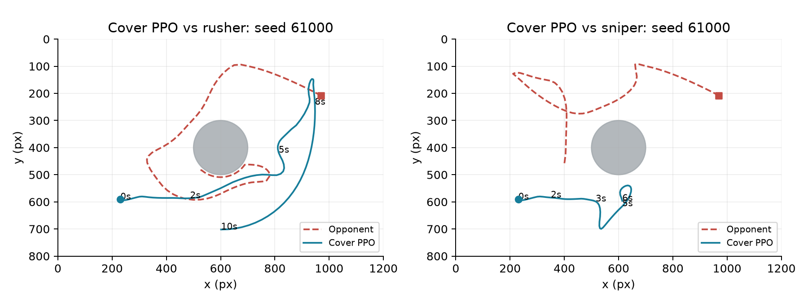

# 中央行星掩體實驗與重現驗證

## 8. 新實驗：中央行星掩體射擊

使用者提出：開局先讓中央行星介於雙方之間，敵北我南、敵東我西；有彈藥時側移探頭射擊，之後退回掩體。這是對既有方法的新增實驗，沒有修改遊戲邏輯、評分器或觀測格式。

## 三段式導航與緊急避彈

CoverBot 先慢速接近行星背面的 180 px 安全半徑，補滿彈匣後朝側面約 1.05 rad 的位置探頭；射擊使彈匣不滿後退回背面補彈。暴露時加速，近距離被追上時允許原反擊，避免為了堅持掩體位置而放棄生存。

掩體導航先產生偏好動作，之後仍完整執行原有 60 步、15 組動作的避彈搜尋，並在閃避轉向後重新檢查射擊角度。所有決策依原始觀測，不用真實時間、測試種子或未提供的隱藏計時器。

教師檢查 300 次避彈決策，預測距離均改善，最小約 0.031 px。訓練後模型另比較 200 次：相較同一模型關閉避彈建議，全部距離改善，中位約 31.5 px。這驗證避彈元件保留，不代表整體戰術一定更強。

## 開局時間的限制

原始 84 維觀測沒有回合 elapsed time，因此 3–5 秒只能以位置 / 速度 / 彈藥近似。第二版教師對 Rusher 的首次射擊中位數約 2.75 秒，對 Sniper 約 5.22 秒；近距離緊急反擊可能更早，不宣稱精確計時。

| 教師版本 | Rusher | Sniper | 性質 |
| --- | --- | --- | --- |
| 第一版 | 35% | 60% | 每對手 20 局，非模型成績 |
| 第二版 | 90% | 70% | 每對手 20 局，非模型成績 |

## 儲存 checkpoint 後的獨立比較

| 固定模型 | 對手 | 勝率 | 平手率 | 首次射擊中位數 |
| --- | --- | --- | --- | --- |
| 原防禦 | Rusher | 92% | 0% | 1.20 秒 |
| 原防禦 | Sniper | 88% | 1% | 1.22 秒 |
| 掩體版 | Rusher | 86% | 0% | 2.85 秒 |
| 掩體版 | Sniper | 74% | 11% | 3.88 秒 |

兩個模型使用相同種子 61000–61099，各對手 100 場；此表是實際 PPO 模型結果。掩體策略作為獨立實驗保存，原通過 baseline 的模型維持為預設。

# 9. 實驗判讀與一鍵重現

上圖是掩體 PPO 在單一種子的前 10 秒軌跡，圓形為中央行星，藍色為模型、紅色為對手。單場示例只能解釋行為，不能代替完整勝率比較。

對 Sniper，開局遮蔽率由 28% 提升至 53%，前 5 秒出艙率由 14% 降至 5%；但平手率由 1% 升至 11%，勝率下降。開局更安全沒有轉化為更高勝率；較長的導航與等待可能減少擊殺窗口，這仍是解釋假設。

## 助教可直接從頭訓練

訓練主檔預設值已改為最終採用的防禦 recipe：直接 python train_astro_party.py 即完成教師資料、模仿初始化與 40,960 步 PPO，輸出 models/model_astro_party.zip。沒有載入舊 checkpoint，也不需要 PowerShell wrapper 或 experiments 資料夾。

已在乾淨目錄以平放的 train_astro_party.py / train_astro_party_env.py 加上原版 core / baseline 重跑。重訓 40,960 步後，全部 policy tensors 與原 reference 完全相同，最大絕對差為 0。ZIP 內嵌程式與 metadata 不同，所以不要求 ZIP 的 SHA-256 相同。

## 試驗與觀看指令

試驗訓練：python train_astro_party.py --controller cover。自動另外存成 models/model_astro_party_cover.zip；原模型備份為 models/model_astro_party_defense_reference.zip。

觀看：python watch_astro_party.py --model models/model_astro_party_cover.zip --opponent sniper --seed 0。訓練與對戰仍用原版 renderer。

W&B 預設 auto：有登入用雲端，無憑證就離線記錄，不要求助教登入。上傳模型 artifact 為額外 --upload-model 選項。訓練檔沒有直接匯入 sys、os、shutil、pathlib 或 subprocess。

W&B run ID：重現 0njzp6y9；掩體訓練 cj240jwb；成對評估 em6va3hq。完整可點選網址見 README_TW.md。三者已由 API 確認 finished 與對應曲線存在。
