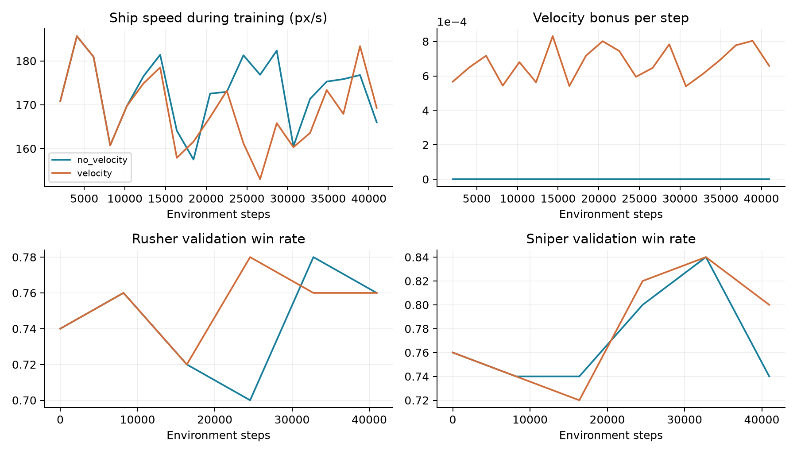

# 高速掩體與速度獎勵實驗

## 10. 高速繞行、速度 reward 與追撞

新增需求為：敵人順時針接近時也順時針逃走、提高移動速度、缺彈時利用中央行星、有一發就能探頭，敵人出艙後立即追撞。這版保留成獨立 fast-cover controller 與 fast_cover reward profile。

| reward / 控制項目 | 實作 |
| --- | --- |
| 速度 bonus | 0.0015 × min(有效速度 / 260, 1) × 情境權重 |
| 情境權重 | 敵船仍在：行星遮蔽內 1、暴露時 0.25；自身出艙不加速度 bonus |
| 追小人時 | 只獎勵朝小人方向的速度；接近係數從舊有效值 2 提高到 6 |
| 一般對射接近係數 | 降低為 0.1，避免 reward 一直把船拉出掩體 |
| 防止純速度刷分 | 整局速度 bonus 上限 2.25 < 最終擊殺 20；每步成本 -0.002 仍大於最大速度 bonus |
| 退避與探頭 | 依觀測角速度追蹤同向繞行；有彈且上一發飛行退避窗口結束即可探頭，不等三發全滿 |

先前看到射線暢通才轉槍，容易高速衝過射擊窗口；新版在接近掩體邊緣時提前瞄準並滑行，不再固定反推煞停。追小人分支在掩體計畫之前，以對方橫向速度加上接近速度追撞，仍保留射擊與緊急避彈。

## 固定模型後的同種子比較

| 版本 | 對手 | 勝率 | 船速 | 退避遮蔽 | 完成率 |
| --- | --- | --- | --- | --- | --- |
| 舊掩體 | Rusher | 86% | 146.0 | 16% | 80% |
| 舊掩體 | Sniper | 76% | 128.5 | 32% | 81% |
| 高速無 bonus | Rusher | 72% | 163.4 | 41% | 69% |
| 高速無 bonus | Sniper | 77% | 168.1 | 40% | 78% |
| 高速有 bonus | Rusher | 72% | 163.0 | 39% | 65% |
| 高速有 bonus | Sniper | 80% | 166.2 | 43% | 78% |

種子 65000–65099，各對手各 100 場。船速單位為 px/s，僅計飛船狀態；退避遮蔽指射後 / 冷卻 / 無彈退避期間的比例；完成率為最終勝場 / 對手出艙次數，包含對手重生造成的失敗機會。

# 11. 速度獎勵對照與結果界線

有 / 無速度 bonus 使用相同 seed 42、相同高速控制、相同追小人係數 6、相同 40,960 步 PPO。兩者 BC 初始化全部權重相同，最大差 0；差異只有速度 bonus 係數 0.0015 / 0。這是單一訓練 seed 的對照，不代表跨 seed 的一般結論。

對 Sniper，舊掩體平均船速 128.5，高速有 bonus 為 166.2 px/s；無 bonus 為 168.1。新版同向繞行比例 69%，無彈遮蔽比例 3%。緊急避彈、瞄準與位置修正仍可改變繞行方向，因此不保證每一幀皆同方向。

這次沒有證據顯示速度 bonus 額外提高速度；主要速度提升來自新導航。無彈時遮蔽仍不理想，追小人完成率也未全面提高，不能把「跑更快、撞擊勝場更多」等同更穩定的策略。

速度快不等於勝率高；應同時看退避遮蔽、追小人完成率與最終擊殺。保留已通過的正式模型，實驗模型另外儲存，不以少數教師對戰或訓練 reward 宣稱打贏 baseline。

## 重現這版實驗

python train_astro_party.py --controller fast-cover。自動採用 fast_cover reward，輸出 models/model_astro_party_fast_cover.zip；預設裸命令仍採原通過版本與 original reward。

關閉速度 bonus 對照：加 --velocity-coef 0，並另設 --save-path models/model_astro_party_fast_cover_novelo。

W&B run ID：有速度 bonus xdfwkau6；無 bonus 4r0t3h22；評估 x4hdfhjo。雲端有 speed、velocity reward、covered、hunt mode 及 PPO loss / 勝率曲線；完整連結與逐局紀錄位置見 README_TW.md。
