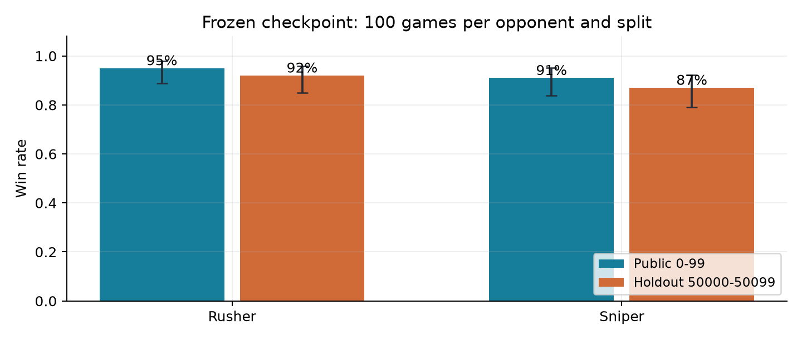
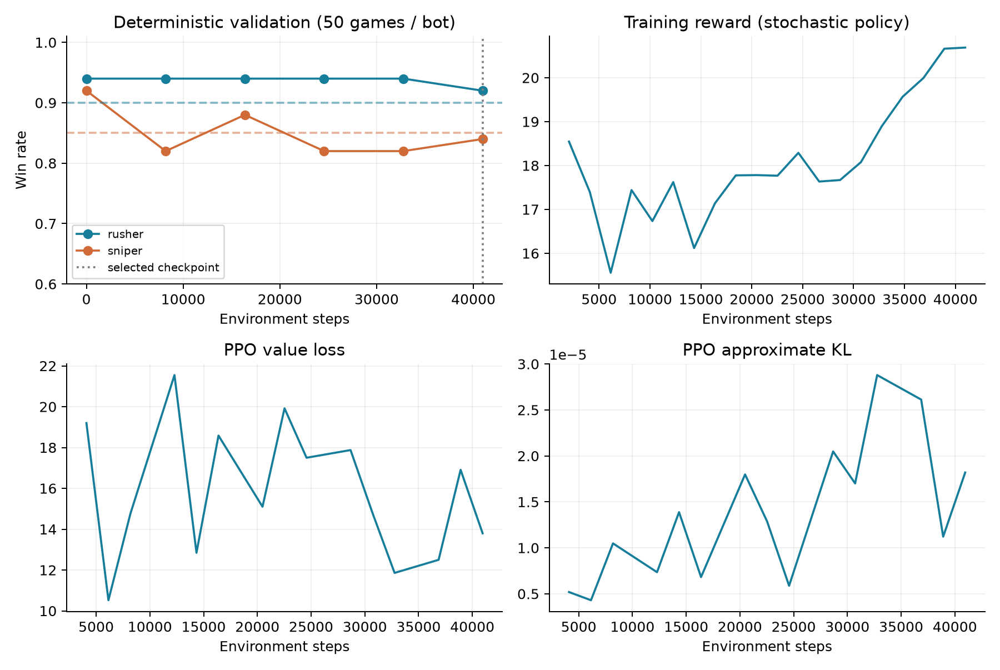
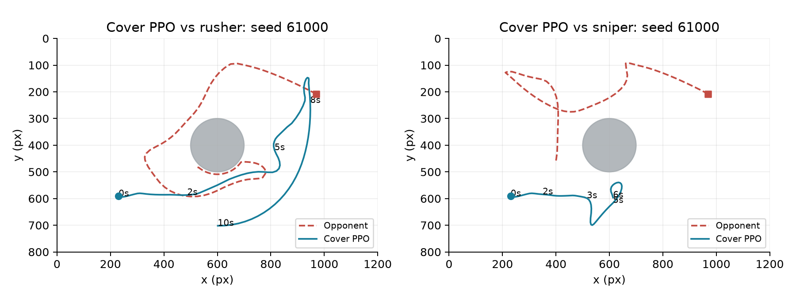
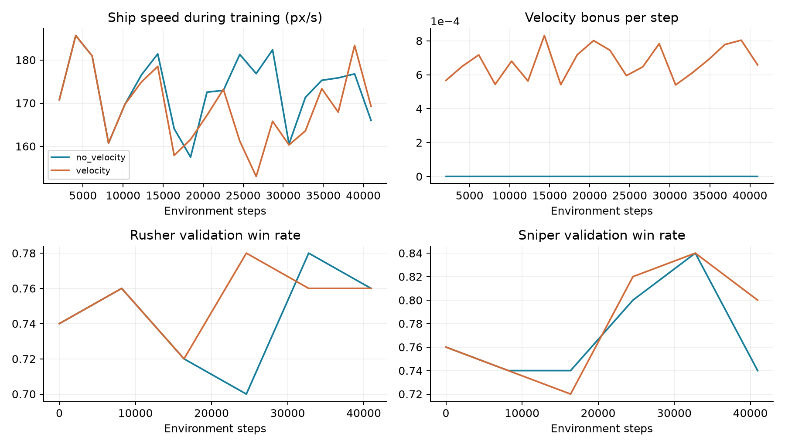

# Astro Party：規則輔助 PPO 實驗報告

日期：2026/11/01　｜　執行環境：本機 CPU　｜　範圍：Astro Party

## 1. 結果與研究問題

目標是以同一份 SB3 模型擊敗 Rusher 與 Sniper。固定 checkpoint 的公開成績為 10/10；計分門檻分別為 90% 與 85%。下面全部是實際載入儲存模型後的對戰結果，並非教師策略成績。

| 測試集 | 對手 | 勝場 | 勝率 | Wilson 95% | 門檻 |
| --- | --- | --- | --- | --- | --- |
| 公開 0–99 | Rusher | 95/100 | 95% | 88.8%–97.8% | 達標 |
| 公開 0–99 | Sniper | 91/100 | 91% | 83.8%–95.2% | 達標 |
| 保留 50000–50099 | Rusher | 92/100 | 92% | 85.0%–95.9% | 達標 |
| 保留 50000–50099 | Sniper | 87/100 | 87% | 79.0%–92.2% | 達標 |

誤差棒為二項比例的 Wilson 95% 區間。公開集已參與開發選模，該區間未校正多次選擇偏差；保留集用於固定模型後的檢查。區間不涵蓋跨訓練 seed 的不確定性，亦不保證助教私有測試或 round robin 排名。

## 方法與完成狀態的界線

最終方案是手工戰術特徵 + 行為模仿初始化 + 真正的 PPO 更新。策略主要先驗來自可解釋控制器，不宣稱端到端從零學習。本次沒有處理 2048；報告需與 2048 部分合併後才是整份作業報告。

W&B：已同步至 https://forge.coreweave.com/wandb/kevinboyulien-national-taiwan-university/astro-party-hw3

# 2. 遊戲機制與 baseline 分析

每步動作為 [turn, thrust, shoot_signal]，前兩項裁切至 [-1,1]，第三項大於零即射擊。回合最長 1500 步，draw 不算勝。擊毀飛船僅使對手變為逃生員；需再次命中或以飛船撞擊逃生員，才算最終勝利。逃生員存活 200 步後重生。

| 機制 | 對策略的影響 |
| --- | --- |
| 84 維觀測；x / 600、y / 400 | 先還原世界座標再計算角度，否則瞄準方向錯誤。 |
| 子彈速度 620 px/s；彈匣 3 發 | 需要提前瞄準，避免無效連射耗盡彈藥。 |
| 轉向上限 3.5 rad/s；每秒 50 步 | 每步最多轉 0.07 rad；遊戲先轉向再開火。 |
| 行星、掩體與隕石會擋子彈 | 須檢查射線；遮擋時需繞行而非直線硬推。 |
| 飛船慣性與倒車推力減半 | 閃避必須預測速度變化，單純距離判斷不足。 |

## 兩個 baseline 的差異

Rusher 使用 120–260 px 作戰距離、較寬鬆的 1.3 射擊容忍係數，且不做子彈閃避。Sniper 使用 380–620 px、較嚴格的 0.8 容忍係數，並搜尋候選動作來避開子彈。兩者共用遮擋繞行、追擊逃生員與自身出艙逃生邏輯。

## 實際檢驗的改進假設

第一，射擊判定應使用本步轉向之後的角度，且閃避改變轉向後必須重新檢查射擊。第二，baseline 先按「當前漂移軌跡」篩選威脅，可能漏掉轉向後才會撞上的子彈；改為對所有可見敵彈檢查候選軌跡。第三，18 步的預測視野偏短，延長可較早閃避。

近距離追擊曾被視為可能破解 Sniper，但診斷對戰並不支持：近距版本在 12 場 Sniper 對戰僅贏 4 場。提高勝率主要來自更完整的防禦預測，而不是一味前衝。提前瞄準乘上 0.8 是驗證選出的啟發式修正，不是物理定律。

# 3. 可解釋控制器與神經網路

## DefenseBot：公開觀測 → 控制建議

先將觀測還原至世界單位，依自身 / 對手是否出艙選擇逃生、追擊或對射。對射保持約 500–700 px，遇遮擋則沿用 baseline 的繞行方式。利用常速度截擊方程估計目標未來位置，速度提前量乘以 0.8；射擊還須滿足視線與角度條件。

對所有觀測到的敵彈，先模擬原建議動作的最小距離。若不夠安全，搜尋 turn ∈ {-1,-0.5,0,0.5,1}、thrust ∈ {-1,0,1} 共 15 種組合；以 60 步（1.2 秒）的預測最小距離評分，加入小幅偏離原轉向的代價。飛船使用 35 px 安全界線，逃生員為 28 px。

最終版本使用簡化自身運動與直線子彈預測，未模擬自身碰撞或敵彈被牆擋住。另測試固定障礙感知的教師及模型，但沒有把教師成績當作最終模型成績。控制器只讀取觀測與公開常數，不讀取測試種子、對手名稱或隱藏狀態，也不預知對方未發射的子彈。

| 元件 | 實際設計 |
| --- | --- |
| 輸入 | 原始 Box(84,)；沒有外部 VecNormalize |
| TacticalFeatures | 3 維規則控制建議 + 前 26 維自身 / 對手狀態 = 29 維 |
| Actor | SB3 內建 MlpPolicy；29 → 3 線性輸出，再由 SB3 裁切 |
| Critic | 29 → 64 → 64 → 1，Tanh activation |
| 可訓練參數 | 6,238，包含 actor、critic 與 3 維 log_std |
| 模型載入 | 原生 PPO.load()；沒有覆寫 predict() |

## 為什麼這樣設計

幾何 MLP 的短跑雖降低模仿誤差，仍會因轉向精度、射擊時機與軌跡分布偏移而失敗。規則特徵把可解釋先驗保留在模型內，使 CPU 上的小網路能學習動作校正。所有最終動作仍經過訓練過的 actor；但不能據此說高階戰術都是神經網路自己學會的。

特徵類別與教師定義位於訓練檔中，執行為 __main__ 後由 cloudpickle 存入 SB3 zip。只快取純函數特徵以加速 PPO 重複讀取 rollout；快取不改變輸出，也不構成跨回合記憶。

# 4. Reward、模仿初始化與 PPO 設定

| 訓練 reward 項目 | 數值 / 說明 |
| --- | --- |
| 最終擊殺 / 自身被殺 | +20 / -20 |
| 擊毀飛船 / 自身被擊毀 | +3 / -3 |
| 取得 laser | +0.1 |
| 每步成本 | -0.002 |
| 接近 shaping | 0.5 × 權重 × (前一步距離 - 本步距離)，距離除以 600 |
| shaping 權重 | 一般 +1；追擊逃生員 +4；自身出艙 -1 |
| 重生 / 擊中隕石 | 0；避免反覆重生或打石頭刷分 |

這個距離 shaping 不是嚴格的 potential-based reward：狀態權重會切換，也沒有以 gamma 修正勢能差，因此不宣稱保持最優策略不變。評分與選模始終使用原版環境的最終擊殺結果。

| 參數 | 實際值 |
| --- | --- |
| 訓練種子 / 對手抽樣 | seed 42；環境 RNG 起點 100042；Rusher / Sniper 各 50% |
| 模仿初始化 | 10,000 個教師步；120 epochs；Adam lr 0.003；batch 約 256 |
| PPO / CPU | 4 個 subprocess env；每個 env n_steps 512；torch threads 1 |
| 更新 | batch 256；每個 rollout 5 epochs；lr 1e-6 |
| 折扣與裁切 | gamma 0.995；GAE lambda 0.95；clip 0.1；target KL 0.02 |
| 探索 | log_std 初值 -3.5；entropy coefficient 0 |
| 驗證與選模 | 每 8,192 步測各 50 局；最大化 min(R/0.90,S/0.85) |
| 本次選中 checkpoint | PPO 累積 40,960 步；完整 run 共 40,960 步 |

最終使用標準 PPO。另測試 AnchoredPPO 將 actor 向 BC 初始化收縮，以保留瞄準精度，但公開開發評估未優於選中的後期標準 PPO checkpoint。評分始終使用標準 PPO.predict。

# 5. 訓練曲線與失敗實驗

上圖是最終候選 run 6o6gk5el 的實際紀錄。步數 0 表示模仿初始化完成；之後才是 PPO。虛線為兩個門檻，垂直線為選中的 40,960 步 checkpoint。較晚的 checkpoint 並不一定更好。

| 實驗 | 驗證局數 / 對手 | 選中 Rusher / Sniper |
| --- | --- | --- |
| 幾何特徵 + BC + PPO，r5zt1smk | 12 | 8.3% / 8.3% |
| 初版規則特徵 PPO，fcxyratm | 12 | 83.3% / 58.3% |
| 25 步防禦 PPO，9hb3syt0 | 50 | 96% / 76% |
| 60 步防禦 PPO，6o6gk5el | 50 | 94% / 88% |
| 收縮式 PPO，yffn89i2 | 50 | 94% / 88% |
| 防禦 PPO 最終 checkpoint，6o6gk5el | 50 | 92% / 84% |

這是逐步開發紀錄，不是嚴格控制所有變因的因果消融：不同實驗的教師、探索量、局數與學習率也有變。不能將差異全部歸因於預測視野，也不能把 12 場與 50 場的比例視為等精度。

模仿後、PPO 前的驗證為 Rusher 94%、Sniper 92%；選中的 PPO 為 92%、84%。這不足以證明 PPO 本身優於教師 / 模仿初始化。主要能力來自手工先驗；不能誇大強化學習的貢獻。

# 6. 測試隔離、重現與 W&B

## 公開集使用與保留集隔離

同一 checkpoint 在驗證 10000–10099 上為 Rusher 90%、Sniper 84%。早期模型的公開測試曾為 94% / 84% 與 95% / 81%；另比較過不同 checkpoint 與教師參數，因此公開集已成為開發與選模回饋，不能稱為全程未見的測試集。最終保留集 50000–50099 在固定最終模型後才評估。

驗證集的 Sniper 成績仍可能低於門檻，因此本次不能宣稱任意 100 個種子都能通過。公開集與獨立保留集的達標，是本報告能支持的實測範圍。

乾淨檢查資料夾只包含原版評分程式、原版遊戲 / renderer / env package、原版 baseline 與提交模型。由於原版 envs/__init__.py 會 import 訓練環境，因此也放入原版訓練環境；沒有放入本次修改的訓練檔或 experiments。

受保護的 game.py、eval_astro_party_env.py、eval_astro_party.py、sniper_bot.py、rusher_bot.py 的 SHA-256 均與修改前相同。逐局評估 JSON 另外記錄 checkpoint hash，可核對兩個測試集使用完全相同的模型。

模型 SHA-256：53d4f1bdab58769406c9b29379c0ee88c27fef7d0a3eb840c7a753ea5691c757

## 重現入口

在 astro_party 目錄執行 run_training.ps1 -Mode online -Epochs 5；具體命令與版本鎖定見 README_TW.md、requirements-lock.txt。模型儲存為 models/model_astro_party.zip；官方評分指令為 python eval_astro_party.py --model models/model_astro_party.zip。保留測試再加 --seed-base 50000。

## W&B 圖表與同步

project：astro-party-hw3。訓練開始前呼叫 wandb.init，記錄 config、bc/mse、reward、episode length、PPO policy / value loss、KL、探索 std 與雙對手勝率。採用 global_step 對齊訓練曲線，checkpoint 與逐局評估另存 artifact / table。

已同步至 https://forge.coreweave.com/wandb/kevinboyulien-national-taiwan-university/astro-party-hw3

W&B 原訓練 run 的模型 artifact 是依驗證挑選的 16,384 步版本；本次交付的是本機 models/model_astro_party.zip 的 40,960 步版本。最終模型、報告與逐局資料的額外上傳被自動核准審查要求明確授權，目前仍保留本機；請勿把原 run artifact 誤認為本次最終交付模型。

若未同步：在根目錄執行 .venv311/Scripts/wandb.exe login，再進入 astro_party 執行 sync_wandb.ps1。不要把 API key 寫進程式。初期兩個 pilot 的訓練已執行，但結尾 artifact 暫存權限失敗；後續以工作目錄內的 WANDB_DATA_DIR / WANDB_CACHE_DIR 修正。

## 實際產出

兩個訓練檔、模型 zip、My Plan、繁體中文 Markdown / PDF 報告、訓練與測試圖表、完整原始紀錄、CPU 重現與同步腳本。本次未提供學號，沒有建立冒充完整作業的學號提交包。

# 7. 限制、可解釋性與後續工作

## 這份實驗能支持什麼

本次以觀測可得的物理量與 baseline 程式設計一個規則輔助策略，並用 SB3 執行模仿初始化及 PPO 訓練。報告的成績來自原版對戰介面，而不是修改評分器或偷偷覆寫 predict。模型小、戰術可追溯，適合逐項解釋。

## 仍有哪些限制

只有一個主要訓練 seed，不能據此估計跨 seed 穩定性。驗證集用於選參數和 checkpoint，會產生選擇偏差；信賴區間只適用於已固定模型的單一測試集。兩個對手都是公開規則 bot，對未知學生模型的泛化能力尚未測試。

最終版本使用簡化自身運動與直線子彈預測，未模擬自身碰撞或敵彈被牆擋住。另測試固定障礙感知的教師及模型，但沒有把教師成績當作最終模型成績。線性 actor 的校正能力有限，微小轉向偏移也可能引發截然不同的後續軌跡。原始 MLP 的低 BC loss 沒有轉化為勝率，顯示離線動作誤差與長期策略表現必須分開評估。

README 允許閱讀 / 模仿 bot、SB3 內建 policy 與訓練檔內的自訂特徵擷取器；本方案據此實作。但未取得完整投影片，若投影片另禁止規則特徵或對 LLM 有額外規範，需依課程規定調整；不可聲稱已核對未提供的規則。

## 若還有更多計算時間

優先做多訓練 seed、凍結後的更大獨立測試，以及完整牆體碰撞感知的避彈。若需純神經策略，可用 DAgger 收集自身偏離教師軌跡後的標記，對射擊正例重採樣並增加瞄準精度；但本次沒有執行這些完整實驗，不能把它們寫成已證實有效。

## 參考與協作揭露

遊戲 / 門檻 / 提交限制：本作業 README.md、envs/game.py、eval_astro_party.py、models/sniper_bot.py、models/rusher_bot.py。

SB3 官方 Policy Networks 文件：https://stable-baselines3.readthedocs.io/en/master/guide/custom_policy.html。使用內建 MlpPolicy、policy_kwargs 與 BaseFeaturesExtractor。

W&B 記錄介面依已安裝 0.31.0 SDK 與 wandb sync --help 驗證；完整套件版本見 requirements-lock.txt。

本次計畫、程式實作、實驗分析與報告由使用者委託 AI 協作完成。使用者應理解方法、核對課程 LLM 使用政策，並按規定揭露協作。未偽造訓練曲線、勝率或雲端上傳狀態。

# 8. 新實驗：中央行星掩體射擊

使用者提出：開局先讓中央行星介於雙方之間，敵北我南、敵東我西；有彈藥時側移探頭射擊，之後退回掩體。這是對既有方法的新增實驗，沒有修改遊戲邏輯、評分器或觀測格式。

## 三段式導航與緊急避彈

CoverBot 先慢速接近行星背面的 180 px 安全半徑，補滿彈匣後朝側面約 1.05 rad 的位置探頭；射擊使彈匣不滿後退回背面補彈。暴露時加速，近距離被追上時允許原反擊，避免為了堅持掩體位置而放棄生存。

掩體導航先產生偏好動作，之後仍完整執行原有 60 步、15 組動作的避彈搜尋，並在閃避轉向後重新檢查射擊角度。所有決策依原始觀測，不用真實時間、測試種子或未提供的隱藏計時器。

教師檢查 300 次避彈決策，預測距離均改善，最小約 0.031 px。訓練後模型另比較 200 次：相較同一模型關閉避彈建議，全部距離改善，中位約 31.5 px。這驗證避彈元件保留，不代表整體戰術一定更強。

## 開局時間的限制

原始 84 維觀測沒有回合 elapsed time，因此 3–5 秒只能以位置 / 速度 / 彈藥近似。第二版教師對 Rusher 的首次射擊中位數約 2.75 秒，對 Sniper 約 5.22 秒；近距離緊急反擊可能更早，不宣稱精確計時。

| 教師版本 | Rusher | Sniper | 性質 |
| --- | --- | --- | --- |
| 第一版 | 35% | 60% | 每對手 20 局，非模型成績 |
| 第二版 | 90% | 70% | 每對手 20 局，非模型成績 |

## 儲存 checkpoint 後的獨立比較

| 固定模型 | 對手 | 勝率 | 平手率 | 首次射擊中位數 |
| --- | --- | --- | --- | --- |
| 原防禦 | Rusher | 92% | 0% | 1.20 秒 |
| 原防禦 | Sniper | 88% | 1% | 1.22 秒 |
| 掩體版 | Rusher | 86% | 0% | 2.85 秒 |
| 掩體版 | Sniper | 74% | 11% | 3.88 秒 |

兩個模型使用相同種子 61000–61099，各對手 100 場；此表是實際 PPO 模型結果。掩體策略作為獨立實驗保存，原通過 baseline 的模型維持為預設。

# 9. 實驗判讀與一鍵重現

上圖是掩體 PPO 在單一種子的前 10 秒軌跡，圓形為中央行星，藍色為模型、紅色為對手。單場示例只能解釋行為，不能代替完整勝率比較。

對 Sniper，開局遮蔽率由 28% 提升至 53%，前 5 秒出艙率由 14% 降至 5%；但平手率由 1% 升至 11%，勝率下降。開局更安全沒有轉化為更高勝率；較長的導航與等待可能減少擊殺窗口，這仍是解釋假設。

## 助教可直接從頭訓練

訓練主檔預設值已改為最終採用的防禦 recipe：直接 python train_astro_party.py 即完成教師資料、模仿初始化與 40,960 步 PPO，輸出 models/model_astro_party.zip。沒有載入舊 checkpoint，也不需要 PowerShell wrapper 或 experiments 資料夾。

已在乾淨目錄以平放的 train_astro_party.py / train_astro_party_env.py 加上原版 core / baseline 重跑。重訓 40,960 步後，全部 policy tensors 與原 reference 完全相同，最大絕對差為 0。ZIP 內嵌程式與 metadata 不同，所以不要求 ZIP 的 SHA-256 相同。

## 試驗與觀看指令

試驗訓練：python train_astro_party.py --controller cover。自動另外存成 models/model_astro_party_cover.zip；原模型備份為 models/model_astro_party_defense_reference.zip。

觀看：python watch_astro_party.py --model models/model_astro_party_cover.zip --opponent sniper --seed 0。訓練與對戰仍用原版 renderer。

W&B 預設 auto：有登入用雲端，無憑證就離線記錄，不要求助教登入。上傳模型 artifact 為額外 --upload-model 選項。訓練檔沒有直接匯入 sys、os、shutil、pathlib 或 subprocess。

W&B run ID：重現 ghme0u0w；掩體訓練 cj240jwb；成對評估 em6va3hq。完整可點選網址見 README_TW.md。三者已由 API 確認 finished 與對應曲線存在。

# 10. 高速繞行、速度 reward 與追撞

新增需求為：敵人順時針接近時也順時針逃走、提高移動速度、缺彈時利用中央行星、有一發就能探頭，敵人出艙後立即追撞。這版保留成獨立 fast-cover controller 與 fast_cover reward profile。

| reward / 控制項目 | 實作 |
| --- | --- |
| 速度 bonus | 0.0015 × min(有效速度 / 260, 1) × 情境權重 |
| 情境權重 | 敵船仍在：行星遮蔽內 1、暴露時 0.25；自身出艙不加速度 bonus |
| 追小人時 | 只獎勵朝小人方向的速度；接近係數從舊有效值 2 提高到 6 |
| 一般對射接近係數 | 降低為 0.1，避免 reward 一直把船拉出掩體 |
| 防止純速度刷分 | 整局速度 bonus 上限 2.25 < 最終擊殺 20；每步成本 -0.002 仍大於最大速度 bonus |
| 退避與探頭 | 依觀測角速度追蹤同向繞行；有彈且上一發飛行退避窗口結束即可探頭，不等三發全滿 |

先前看到射線暢通才轉槍，容易高速衝過射擊窗口；新版在接近掩體邊緣時提前瞄準並滑行，不再固定反推煞停。追小人分支在掩體計畫之前，以對方橫向速度加上接近速度追撞，仍保留射擊與緊急避彈。

## 固定模型後的同種子比較

| 版本 | 對手 | 勝率 | 船速 | 退避遮蔽 | 完成率 |
| --- | --- | --- | --- | --- | --- |
| 舊掩體 | Rusher | 86% | 146.0 | 16% | 80% |
| 舊掩體 | Sniper | 76% | 128.5 | 32% | 81% |
| 高速無 bonus | Rusher | 72% | 163.4 | 41% | 69% |
| 高速無 bonus | Sniper | 77% | 168.1 | 40% | 78% |
| 高速有 bonus | Rusher | 72% | 163.0 | 39% | 65% |
| 高速有 bonus | Sniper | 80% | 166.2 | 43% | 78% |

種子 65000–65099，各對手各 100 場。船速單位為 px/s，僅計飛船狀態；退避遮蔽指射後 / 冷卻 / 無彈退避期間的比例；完成率為最終勝場 / 對手出艙次數，包含對手重生造成的失敗機會。

# 11. 速度獎勵對照與結果界線

有 / 無速度 bonus 使用相同 seed 42、相同高速控制、相同追小人係數 6、相同 40,960 步 PPO。兩者 BC 初始化全部權重相同，最大差 0；差異只有速度 bonus 係數 0.0015 / 0。這是單一訓練 seed 的對照，不代表跨 seed 的一般結論。

對 Sniper，舊掩體平均船速 128.5，高速有 bonus 為 166.2 px/s；無 bonus 為 168.1。新版同向繞行比例 69%，無彈遮蔽比例 3%。緊急避彈、瞄準與位置修正仍可改變繞行方向，因此不保證每一幀皆同方向。

這次沒有證據顯示速度 bonus 額外提高速度；主要速度提升來自新導航。無彈時遮蔽仍不理想，追小人完成率也未全面提高，不能把「跑更快、撞擊勝場更多」等同更穩定的策略。

速度快不等於勝率高；應同時看退避遮蔽、追小人完成率與最終擊殺。保留已通過的正式模型，實驗模型另外儲存，不以少數教師對戰或訓練 reward 宣稱打贏 baseline。

## 重現這版實驗

python train_astro_party.py --controller fast-cover。自動採用 fast_cover reward，輸出 models/model_astro_party_fast_cover.zip；預設裸命令仍採原通過版本與 original reward。

關閉速度 bonus 對照：加 --velocity-coef 0，並另設 --save-path models/model_astro_party_fast_cover_novelo。

W&B run ID：有速度 bonus xdfwkau6；無 bonus 4r0t3h22；評估 x4hdfhjo。雲端有 speed、velocity reward、covered、hunt mode 及 PPO loss / 勝率曲線；完整連結與逐局紀錄位置見 README_TW.md。
