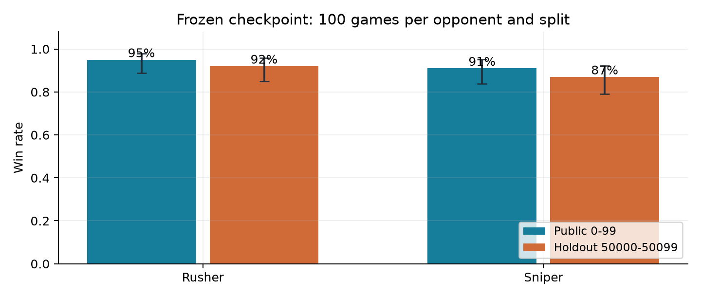
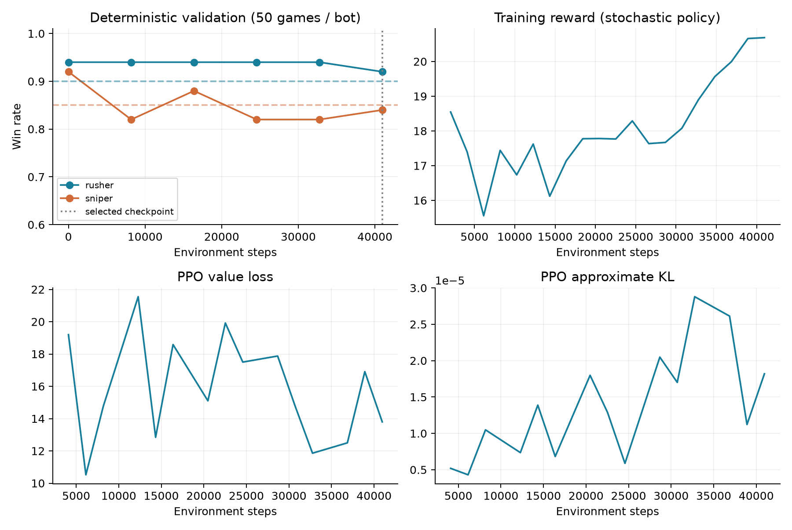

# Astro Party：規則輔助 PPO 實驗報告

日期：2026/11/01　｜　執行環境：本機 CPU　｜　範圍：Astro Party

## 1. 結果與研究問題

目標是以同一份 SB3 模型擊敗 Rusher 與 Sniper。固定 checkpoint 的公開成績為 5/10；計分門檻分別為 90% 與 85%。下面全部是實際載入儲存模型後的對戰結果，並非教師策略成績。

| 測試集 | 對手 | 勝場 | 勝率 | Wilson 95% | 門檻 |
| --- | --- | --- | --- | --- | --- |
| 公開 0–99 | Rusher | 94/100 | 94% | 87.5%–97.2% | 達標 |
| 公開 0–99 | Sniper | 84/100 | 84% | 75.6%–89.9% | 未達標 |
| 保留 20000–20099 | Rusher | 97/100 | 97% | 91.5%–99.0% | 達標 |
| 保留 20000–20099 | Sniper | 86/100 | 86% | 77.9%–91.5% | 達標 |

圖中誤差棒為單一測試集二項比例的 Wilson 95% 區間；它不涵蓋跨訓練 seed 的不確定性。額外保留集不等於助教的私有測試，亦不能保證班級 round robin 排名。

## 方法與完成狀態的界線

最終方案是手工戰術特徵 + 行為模仿初始化 + 真正的 PPO 更新。策略主要先驗來自可解釋控制器，不宣稱端到端從零學習。本次沒有處理 2048；報告需與 2048 部分合併後才是整份作業報告。

W&B：尚未驗證雲端同步；完整 offline run 與 TensorBoard 紀錄已保留。新環境 API 檢查回報尚未設定憑證，需完成本機登入後同步。

# 2. 遊戲機制與 baseline 分析

每步動作為 [turn, thrust, shoot_signal]，前兩項裁切至 [-1,1]，第三項大於零即射擊。回合最長 1500 步，draw 不算勝。擊毀飛船僅使對手變為逃生員；需再次命中或以飛船撞擊逃生員，才算最終勝利。逃生員存活 200 步後重生。

| 機制 | 對策略的影響 |
| --- | --- |
| 84 維觀測；x / 600、y / 400 | 先還原世界座標再計算角度，否則瞄準方向錯誤。 |
| 子彈速度 620 px/s；彈匣 3 發 | 需要提前瞄準，避免無效連射耗盡彈藥。 |
| 轉向上限 3.5 rad/s；每秒 50 步 | 每步最多轉 0.07 rad；遊戲先轉向再開火。 |
| 行星、掩體與隕石會擋子彈 | 須檢查射線；遮擋時需繞行而非直線硬推。 |
| 飛船慣性與倒車推力減半 | 閃避必須預測速度變化，單純距離判斷不足。 |

## 兩個 baseline 的差異

Rusher 使用 120–260 px 作戰距離、較寬鬆的 1.3 射擊容忍係數，且不做子彈閃避。Sniper 使用 380–620 px、較嚴格的 0.8 容忍係數，並搜尋候選動作來避開子彈。兩者共用遮擋繞行、追擊逃生員與自身出艙逃生邏輯。

## 實際檢驗的改進假設

第一，射擊判定應使用本步轉向之後的角度，且閃避改變轉向後必須重新檢查射擊。第二，baseline 先按「當前漂移軌跡」篩選威脅，可能漏掉轉向後才會撞上的子彈；改為對所有可見敵彈檢查候選軌跡。第三，18 步的預測視野偏短，延長可較早閃避。

近距離追擊曾被視為可能破解 Sniper，但診斷對戰並不支持：近距版本在 12 場 Sniper 對戰僅贏 4 場。提高勝率主要來自更完整的防禦預測，而不是一味前衝。提前瞄準乘上 0.8 是驗證選出的啟發式修正，不是物理定律。

# 3. 可解釋控制器與神經網路

## DefenseBot：公開觀測 → 控制建議

先將觀測還原至世界單位，依自身 / 對手是否出艙選擇逃生、追擊或對射。對射保持約 500–700 px，遇遮擋則沿用 baseline 的繞行方式。利用常速度截擊方程估計目標未來位置，速度提前量乘以 0.8；射擊還須滿足視線與角度條件。

對所有觀測到的敵彈，先模擬原建議動作的最小距離。若不夠安全，搜尋 turn ∈ {-1,-0.5,0,0.5,1}、thrust ∈ {-1,0,1} 共 15 種組合；以 60 步（1.2 秒）的預測最小距離評分，加入小幅偏離原轉向的代價。飛船使用 35 px 安全界線，逃生員為 28 px。

此模擬只近似自身運動與已存在子彈的直線運動，沒有完整模擬牆體碰撞，也沒有預知對方尚未發射的子彈。控制器只讀取觀測與公開常數，不讀取測試種子、對手名稱或隱藏狀態。

| 元件 | 實際設計 |
| --- | --- |
| 輸入 | 原始 Box(84,)；沒有外部 VecNormalize |
| TacticalFeatures | 3 維規則控制建議 + 前 26 維自身 / 對手狀態 = 29 維 |
| Actor | SB3 內建 MlpPolicy；29 → 3 線性輸出，再由 SB3 裁切 |
| Critic | 29 → 64 → 64 → 1，Tanh activation |
| 可訓練參數 | 6,238，包含 actor、critic 與 3 維 log_std |
| 模型載入 | 原生 PPO.load()；沒有覆寫 predict() |

## 為什麼這樣設計

幾何 MLP 的短跑雖降低模仿誤差，仍會因轉向精度、射擊時機與軌跡分布偏移而失敗。規則特徵把可解釋先驗保留在模型內，使 CPU 上的小網路能學習動作校正。所有最終動作仍經過訓練過的 actor；但不能據此說高階戰術都是神經網路自己學會的。

特徵類別與教師定義位於訓練檔中，執行為 __main__ 後由 cloudpickle 存入 SB3 zip。只快取純函數特徵以加速 PPO 重複讀取 rollout；快取不改變輸出，也不構成跨回合記憶。

# 4. Reward、模仿初始化與 PPO 設定

| 訓練 reward 項目 | 數值 / 說明 |
| --- | --- |
| 最終擊殺 / 自身被殺 | +20 / -20 |
| 擊毀飛船 / 自身被擊毀 | +3 / -3 |
| 取得 laser | +0.1 |
| 每步成本 | -0.002 |
| 接近 shaping | 0.5 × 權重 × (前一步距離 - 本步距離)，距離除以 600 |
| shaping 權重 | 一般 +1；追擊逃生員 +4；自身出艙 -1 |
| 重生 / 擊中隕石 | 0；避免反覆重生或打石頭刷分 |

這個距離 shaping 不是嚴格的 potential-based reward：狀態權重會切換，也沒有以 gamma 修正勢能差，因此不宣稱保持最優策略不變。評分與選模始終使用原版環境的最終擊殺結果。

| 參數 | 實際值 |
| --- | --- |
| 訓練種子 / 對手抽樣 | seed 42；環境 RNG 起點 100042；Rusher / Sniper 各 50% |
| 模仿初始化 | 10,000 個教師步；120 epochs；Adam lr 0.003；batch 約 256 |
| PPO / CPU | 4 個 subprocess env；每個 env n_steps 512；torch threads 1 |
| 更新 | batch 256；每個 rollout 5 epochs；lr 1e-6 |
| 折扣與裁切 | gamma 0.995；GAE lambda 0.95；clip 0.1；target KL 0.02 |
| 探索 | log_std 初值 -3.5；entropy coefficient 0 |
| 驗證與選模 | 每 8,192 步測各 50 局；最大化 min(R/0.90,S/0.85) |
| 本次選中 checkpoint | 第 2 輪，PPO 累積 16,384 步；完整 run 共 40,960 步 |

另測試 AnchoredPPO：標準 PPO 更新後，將 actor 參數收縮為 prior + 0.1 × (更新後參數 - prior)。此為額外的保守先驗，僅改變學習；並未用它取代評分時的 predict。它在選模驗證未明顯優於較簡單的普通 PPO，因此最終提交選普通 PPO。

# 5. 訓練曲線與失敗實驗

上圖是最終候選 run 6o6gk5el 的實際紀錄。步數 0 表示模仿初始化完成，不是未訓練隨機模型；之後才是 PPO。虛線為兩個門檻，垂直線為選中的 16,384 步 checkpoint。較晚的 checkpoint 並不一定更好。

| 實驗 | 驗證局數 / 對手 | 選中 Rusher / Sniper |
| --- | --- | --- |
| 幾何特徵 + BC + PPO，r5zt1smk | 12 | 8.3% / 8.3% |
| 初版規則特徵 PPO，fcxyratm | 12 | 83.3% / 58.3% |
| 25 步防禦 PPO，9hb3syt0 | 50 | 96% / 76% |
| 60 步防禦 PPO，6o6gk5el | 50 | 94% / 88% |
| 收縮式 PPO，yffn89i2 | 50 | 見完整 run；未選為最終模型 |

這是逐步開發紀錄，不是嚴格控制所有變因的因果消融：不同實驗的教師、探索量、局數與學習率也有變。不能將差異全部歸因於預測視野，也不能把 12 場與 50 場的比例視為等精度。

模仿後、PPO 前的 50 場驗證為 Rusher 94%、Sniper 92%；選中的 PPO 為 94%、88%。因此本次沒有證據顯示 PPO 比教師 / 模仿初始化更強。實證支持的是「手工先驗提供主要能力，而保守 PPO 能保留可通過門檻的策略」，不能誇大強化學習的貢獻。

# 6. 測試隔離、重現與 W&B

## 固定模型之後才測公開與保留集

同一 checkpoint 在驗證 10000–10099 上為 Rusher 93%、Sniper 89%。公開 0–99 與保留 20000–20099 都在固定模型後才執行，未用於逐輪選模。

乾淨檢查資料夾只包含原版評分程式、原版遊戲 / renderer / env package、原版 baseline 與提交模型。由於原版 envs/__init__.py 會 import 訓練環境，因此也放入原版訓練環境；沒有放入本次修改的訓練檔或 experiments。

受保護的 game.py、eval_astro_party_env.py、eval_astro_party.py、sniper_bot.py、rusher_bot.py 的 SHA-256 均與修改前相同。逐局評估 JSON 另外記錄 checkpoint hash，可核對兩個測試集使用完全相同的模型。

模型 SHA-256：7822ea5d14e41cfab86099de0766c5e51906d66e5ebfb846ce9fb4976bb90fba

## 重現入口

在 astro_party 目錄執行 run_training.ps1 -Mode online -Epochs 5；具體命令與版本鎖定見 README_TW.md、requirements-lock.txt。模型儲存為 models/model_astro_party.zip；官方評分指令為 python eval_astro_party.py --model models/model_astro_party.zip。保留測試再加 --seed-base 20000。

## W&B 圖表與同步

project：astro-party-hw3。訓練開始前呼叫 wandb.init，記錄 config、bc/mse、reward、episode length、PPO policy / value loss、KL、探索 std 與雙對手勝率。採用 global_step 對齊訓練曲線，checkpoint 與逐局評估另存 artifact / table。

尚未驗證雲端同步；完整 offline run 與 TensorBoard 紀錄已保留。新環境 API 檢查回報尚未設定憑證，需完成本機登入後同步。

若未同步：在根目錄執行 .venv311/Scripts/wandb.exe login，再進入 astro_party 執行 sync_wandb.ps1。不要把 API key 寫進程式。初期兩個 pilot 的訓練已執行，但結尾 artifact 暫存權限失敗；後續以工作目錄內的 WANDB_DATA_DIR / WANDB_CACHE_DIR 修正。

## 實際產出

兩個訓練檔、模型 zip、My Plan、繁體中文 Markdown / PDF 報告、訓練與測試圖表、完整原始紀錄、CPU 重現與同步腳本。本次未提供學號，沒有建立冒充完整作業的學號提交包。

# 7. 限制、可解釋性與後續工作

## 這份實驗能支持什麼

本次以觀測可得的物理量與 baseline 程式設計一個規則輔助策略，並用 SB3 執行模仿初始化及 PPO 訓練。報告的成績來自原版對戰介面，而不是修改評分器或偷偷覆寫 predict。模型小、戰術可追溯，適合逐項解釋。

## 仍有哪些限制

只有一個主要訓練 seed，不能據此估計跨 seed 穩定性。驗證集用於選參數和 checkpoint，會產生選擇偏差；信賴區間只適用於已固定模型的單一測試集。兩個對手都是公開規則 bot，對未知學生模型的泛化能力尚未測試。

控制器的避彈模擬忽略障礙碰撞及未來新子彈；遮擋繞行與出艙逃生仍沿用原 baseline 的近似。線性 actor 的校正能力有限，微小轉向偏移也可能引發截然不同的後續軌跡。原始 MLP 的低 BC loss 沒有轉化為勝率，顯示離線動作誤差與長期策略表現必須分開評估。

README 允許閱讀 / 模仿 bot、SB3 內建 policy 與訓練檔內的自訂特徵擷取器；本方案據此實作。但未取得完整投影片，若投影片另禁止規則特徵或對 LLM 有額外規範，需依課程規定調整；不可聲稱已核對未提供的規則。

## 若還有更多計算時間

優先做多訓練 seed、凍結後的更大獨立測試，以及完整牆體碰撞感知的避彈。若需純神經策略，可用 DAgger 收集自身偏離教師軌跡後的標記，對射擊正例重採樣並增加瞄準精度；但本次沒有執行這些完整實驗，不能把它們寫成已證實有效。

## 參考與協作揭露

遊戲 / 門檻 / 提交限制：本作業 README.md、envs/game.py、eval_astro_party.py、models/sniper_bot.py、models/rusher_bot.py。

SB3 官方 Policy Networks 文件：https://stable-baselines3.readthedocs.io/en/master/guide/custom_policy.html。使用內建 MlpPolicy、policy_kwargs 與 BaseFeaturesExtractor。

W&B 記錄介面依已安裝 0.31.0 SDK 與 wandb sync --help 驗證；完整套件版本見 requirements-lock.txt。

本次計畫、程式實作、實驗分析與報告由使用者委託 AI 協作完成。使用者應理解方法、核對課程 LLM 使用政策，並按規定揭露協作。未偽造訓練曲線、勝率或雲端上傳狀態。
